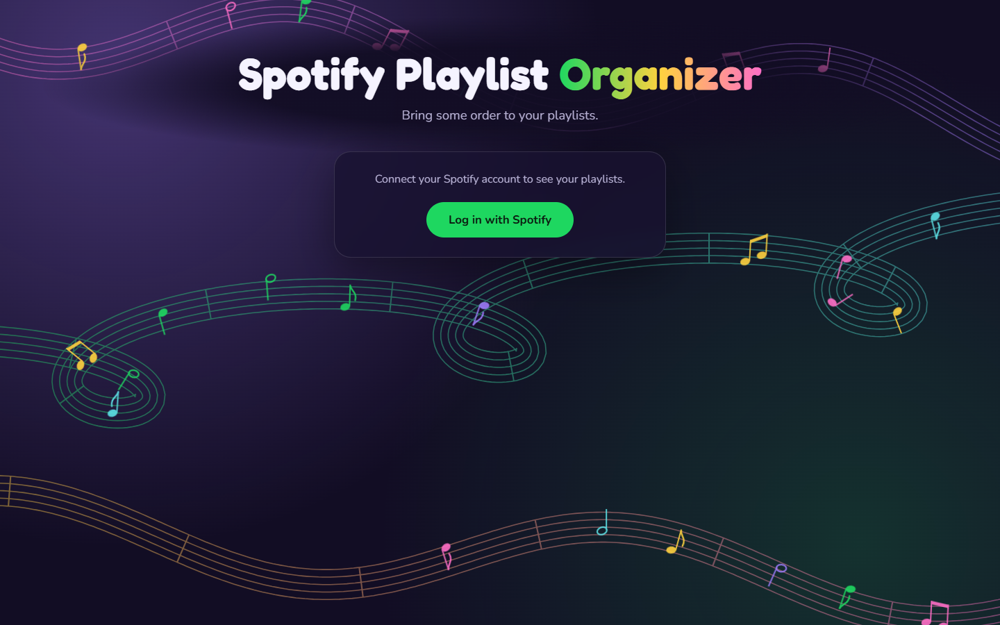
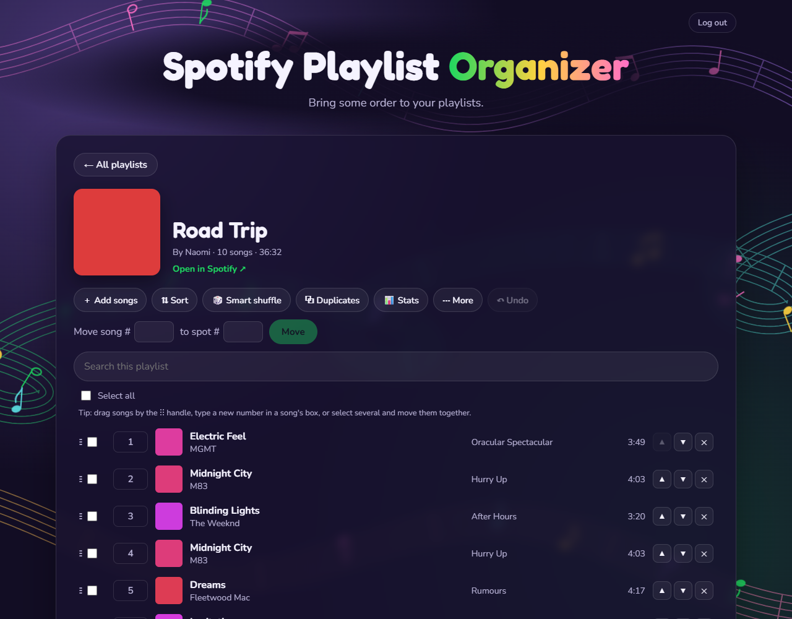
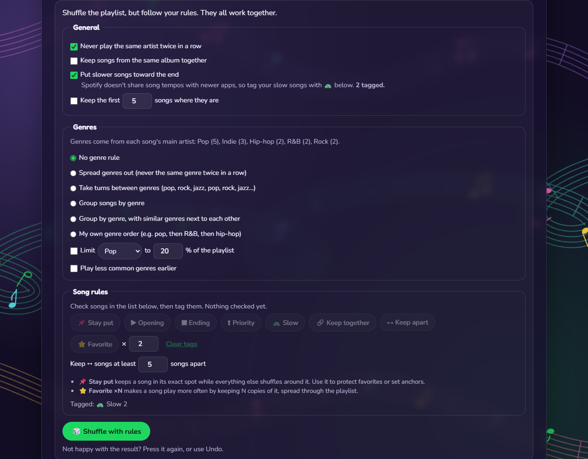

# Spotify Playlist Organizer

A web app for getting your Spotify playlists in exactly the order you want. Log in with your Spotify account to reorder songs by typing a spot number or dragging, sort and clean up playlists, and shuffle with rules, like never playing the same artist twice in a row or starting with pop and ending with hip-hop. Every change is saved straight to Spotify.



## Features

### Reorder songs your way
- **Move a song to a spot:** "Move song #1 to spot #3" moves it with a single request to Spotify.
- **Type a new number** in any song's position box, or use the ▲/▼ arrows.
- **Drag and drop** songs by their handle.
- **Select several songs** and move them to a spot together, remove them, or copy or move them to another playlist.



### Clean up and build playlists
- **Sort** by title, artist, album, release date, date added or length, or reverse or shuffle the order.
- **Find duplicates:** finds exact copies and different versions of the same song, and removes the extras.
- **Add songs** by searching Spotify, and remove songs.
- **Merge** another playlist in (optionally skipping songs that are already there), or **duplicate** a playlist as a private copy.
- **Undo** up to 20 changes.
- **Stats:** total length, top artists, number of artists, and songs by decade.

### Smart shuffle
Shuffle with rules. Turn on as many as you like: the shuffle tries many orders and keeps the one that breaks the fewest rules, and tells you if one couldn't be met.



**General**
- Never play the same artist twice in a row.
- Keep songs from the same album together.
- Put slower songs toward the end.
- Keep the first few songs where they are.

**Genres**
- Spread genres out, take turns between genres, or group them, with similar genres next to each other or in your own order (for example pop, then R&B, then hip-hop).
- Limit a genre to a percentage of the playlist.
- Play less common genres earlier.

**Song rules.** Check songs, then tag them. Tags are remembered per playlist.

| Tag | What it does |
| --- | --- |
| 📌 Stay put | Keeps the song in its exact spot while everything else shuffles around it |
| ▶ Opening / ⏹ Ending | The song plays first / last |
| 🔗 Keep together | The songs stay next to each other |
| ↔ Keep apart | The songs stay at least a set number of songs apart |
| ⬆ Priority | The song tends to come earlier |
| 🐢 Slow | The song goes toward the end |
| ⭐ Favorite ×N | Keeps N copies of the song, spread through the playlist, so it plays more often |

### Also
- You stay logged in after a refresh, and the browser's back and forward buttons work.
- Works on phones.
- Loads every playlist in your library, however many there are.

## Running it yourself

You'll need [Node.js](https://nodejs.org/) and a Spotify account.

1. **Create a Spotify app** in the [Spotify Developer Dashboard](https://developer.spotify.com/dashboard). Under its settings, add this Redirect URI exactly: `http://127.0.0.1:3000/callback`, and tick **Web API**.
2. **Clone and install:**
   ```bash
   git clone https://github.com/Naomi304/Spotify-Playlist-Organizer.git
   cd Spotify-Playlist-Organizer
   npm install
   ```
3. **Add your settings:** copy `.env.example` to `.env.local` and put in your app's Client ID. No client secret is needed, and git ignores `.env.local`.
4. **Start it:**
   ```bash
   npm start
   ```
   It opens at `http://127.0.0.1:3000`. Use that address, not `localhost`, because Spotify only accepts `127.0.0.1` for local redirect URIs.

## How it works

- **Built with** React (Create React App) and the Spotify Web API, through [spotify-web-api-js](https://github.com/JMPerez/spotify-web-api-js). There's no backend: everything runs in the browser.
- **Login** uses Spotify's Authorization Code flow with PKCE, the secure way for browser apps. No client secret is stored anywhere.
- **Saving changes:** every edit works out the new order locally first, then makes the fewest requests needed to make Spotify match. Sorting moves only the songs that are out of place. If Spotify asks the app to slow down, it waits and retries.
- **Checking:** after bigger changes, the app reloads the playlist from Spotify to confirm the result.

```
src/
  App.js              Login, playlist list, page navigation
  PlaylistView.js     A single playlist: track list, tools, undo
  PlaylistPanels.js   Add songs, sort, duplicates, stats, smart shuffle panels
  TrackRow.js         One song row
  playlistTools.js    Sorting, duplicates, stats and the smart shuffle engine
  spotifySync.js      Reading playlists and saving changes back to Spotify
  MusicBackground.js  The animated sheet-music background
```

## Limitations

These come from Spotify's API rather than the app:

- **Song tempo data** isn't available to apps created after November 2024. For "slower songs toward the end", tag your slow songs with 🐢 instead.
- **Genres** come from each song's main artist, because Spotify doesn't give songs a genre. If Spotify doesn't share genres with your app, the genre rules switch off.
- **Removing one copy of a duplicated song:** Spotify removes every copy at once, so the app puts back the copies you're keeping. Those show a new "date added".
- **Local files** from your computer can't be added, removed or copied through the API.
- **Who can log in:** new Spotify apps start in development mode, where only accounts you add under **User Management** in the dashboard can log in.
